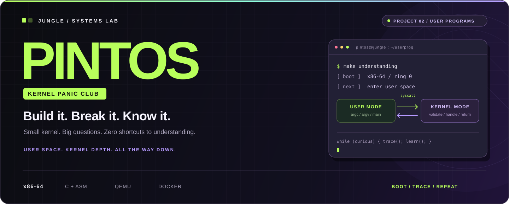

<p align="center">
  
</p>

<div align="center">

### 🌴 커널은 작게. 호기심은 크게. 디버깅은 끝까지.

**KRAFTON JUNGLE · SYSTEMS PROGRAMMING · x86-64**

C로 스레드를 움직이고, 사용자 프로그램을 깨우고, 메모리의 경계를 지킵니다.<br />
직접 만들고, 직접 깨뜨리고, 마침내 내 말로 설명하는 운영체제 프로젝트.


[](https://github.com/45sangmin99/SW-AI-W07-PintOS/stargazers)

**[🚀 시작하기](#quick-start)** &nbsp;·&nbsp;
**[🧠 지금 만드는 것](#current-mission)** &nbsp;·&nbsp;
**[🧪 테스트](#testing)** &nbsp;·&nbsp;
**[🗺️ 코드 지도](#code-map)** &nbsp;·&nbsp;
**[📘 공식 명세](https://casys-kaist.github.io/pintos-kaist/)**

</div>

<br />

> **💥 KERNEL PANIC CLUB**
>
> 패닉을 만나면 로그를 읽고, 가설을 세우고, 원인을 좁힙니다.<br />
> 초록색 PASS 옆에는, 왜 통과했는지 설명할 수 있는 사람이 남습니다.

<br />

<a id="current-mission"></a>
## 🧠 CURRENT MISSION — User Programs

**지금은 Project 2. 커널 안에서만 움직이던 코드를 사용자 프로그램의 세계와 연결합니다.**

<table>
  <tr>
    <td width="33%" valign="top">
      <h3>📦 01 / PASS IT RIGHT</h3>
      <strong>Argument Passing</strong>
      <p>명령행을 나누고, 문자열과 포인터를 사용자 스택에 배치합니다. argc·argv를 x86-64 호출 규약에 맞춰 전달합니다.</p>
      <sub>ELF · User Stack · RDI / RSI</sub>
    </td>
    <td width="33%" valign="top">
      <h3>🚪 02 / CROSS THE LINE</h3>
      <strong>System Calls</strong>
      <p>사용자 요청을 해석하고 메모리 접근을 검증합니다. 커널 서비스를 실행한 뒤 결과를 사용자에게 돌려줍니다.</p>
      <sub>Privilege · intr_frame · Validation</sub>
    </td>
    <td width="33%" valign="top">
      <h3>🧬 03 / KEEP IT ALIVE</h3>
      <strong>Process Lifecycle</strong>
      <p>프로세스를 복제하고, 실행 이미지를 교체하고, 자식의 종료를 기다립니다. 자원 소유권과 동기화까지 함께 다룹니다.</p>
      <sub>fork · exec · wait · exit</sub>
    </td>
  </tr>
</table>

<br />

### ⚡ One request. Two worlds.

우리가 연결할 시스템 콜의 큰 흐름입니다.


**주소가 사용자 영역인지, 매핑되어 있는지, 접근 권한이 맞는지.**<br />
사용자와 커널 사이의 경계에서, 모든 인자를 다시 확인합니다.

<br />

## 🛣️ THE JOURNEY

| Chapter | 우리가 다루는 것 | 현재 위치 |
| :--- | :--- | :---: |
| **01 · Threads** | Alarm Clock · Priority Scheduling · Synchronization · MLFQS | 🧱 기반 코드 |
| **02 · User Programs** | Argument Passing · System Calls · Process Control · File I/O | 🔥 현재 집중 |
| **03 · Virtual Memory** | 주소 공간 · 페이지 관리 · 메모리 자원 | 🔜 다음 단계 |
| **04 · File System** | 파일과 디렉터리 · 영속적인 데이터 관리 | 🔭 이후 단계 |

진행 상태와 검증 결과는 **[Issues](https://github.com/45sangmin99/SW-AI-W07-PintOS/issues)**와 **[Pull Requests](https://github.com/45sangmin99/SW-AI-W07-PintOS/pulls)**에 기록합니다.

<br />

## 🛠️ THE STACK

| Layer | Tools | What happens here |
| :--- | :--- | :--- |
| **Architecture** | x86-64 | 레지스터 · 권한 수준 · 주소 공간 |
| **Kernel** | C · Assembly | 스케줄링 · 시스템 콜 · 메모리 관리 |
| **Build** | GCC · GNU Make | 커널과 사용자 실행 파일 빌드 |
| **Runtime** | QEMU | Pintos 부팅 · 프로그램 실행 · 테스트 |
| **Debug** | GDB | 브레이크포인트 · 레지스터 · 스택 추적 |
| **Workspace** | Ubuntu 22.04 · Docker · VS Code Dev Containers | 같은 환경에서 개발하고 결과 비교 |

환경의 실제 설정은 [Dockerfile](.devcontainer/Dockerfile)과 [devcontainer.json](.devcontainer/devcontainer.json)에 있습니다.

<br />

<a id="quick-start"></a>
## 🚀 QUICK START

### 01 / 저장소 가져오기

호스트 터미널에서 실행합니다. 아래는 현재 인자 전달 작업 브랜치 기준입니다.

```bash
git clone --branch feature/argument/woong https://github.com/45sangmin99/SW-AI-W07-PintOS.git
cd SW-AI-W07-PintOS
```

### 02 / 컨테이너로 입장

1. [Docker Desktop](https://www.docker.com/products/docker-desktop/)을 실행합니다.
2. [VS Code](https://code.visualstudio.com/)에 [Dev Containers](https://marketplace.visualstudio.com/items?itemName=ms-vscode-remote.remote-containers)를 설치합니다.
3. 저장소 최상위 폴더를 열고 명령 팔레트에서 **Dev Containers: Reopen in Container**를 선택합니다.

컨테이너에 Git·GCC·Make·GDB·QEMU가 설치됩니다. 이후 빌드와 테스트는 **컨테이너 안의 Bash 터미널**에서 실행합니다.

### 03 / 사용자 프로그램 빌드

저장소 최상위 폴더에서 실행합니다.

```bash
export PATH="$PWD/pintos/utils:$PATH"
cd pintos/userprog
make
```

> 🧭 Project 1은 `pintos/threads`, Project 2는 `pintos/userprog`에서 빌드합니다. 테스트 통과 여부는 각 기능의 구현 진도에 따라 달라집니다.

<details>
<summary><strong>🩹 Windows · 줄바꿈 · 경로가 말썽일 때</strong></summary>

**`python3\r`, `bash\r`, `syntax error near fi` 오류**

실행 스크립트가 CRLF로 저장되었는지 확인합니다. 해당 오류가 발생했다면 컨테이너에서 저장소 최상위 폴더로 이동한 뒤 LF로 정리합니다.

```bash
sed -i 's/\r$//' pintos/activate pintos/utils/pintos pintos/utils/pintos-mkdisk pintos/utils/backtrace
```

**터미널 시작 시 예전 `/workspaces/pintos_22.04_lab_docker` 경로 오류**

현재 Dockerfile의 Bash 시작 설정에는 이전 저장소 이름이 들어 있습니다. 위 Quick Start는 실제 저장소 최상위 폴더에서 PATH를 직접 설정하므로 그 경로에 의존하지 않습니다.

**`pintos: command not found`**

저장소 최상위 폴더에서 `export PATH="$PWD/pintos/utils:$PATH"`를 실행했는지 확인합니다.

</details>

<br />

<a id="testing"></a>
## 🧪 MAKE IT WORK. PROVE IT.

### Project 2 — 전체 테스트

환경 설정을 마친 컨테이너에서 실행합니다.

```bash
cd /workspaces/SW-AI-W07-PintOS/pintos/userprog
make check
```

### 하나씩 확인하기

`pintos/userprog/build`에서 원하는 테스트의 `.result`를 대상으로 지정합니다.

```bash
cd /workspaces/SW-AI-W07-PintOS/pintos/userprog/build
make tests/userprog/args-none.result
make tests/userprog/args-single.result
make tests/userprog/args-multiple.result
```

| 파일 | 확인할 내용 |
| :--- | :--- |
| `build/results` | 전체 테스트 요약 |
| `build/tests/userprog/*.result` | 각 테스트의 판정 |
| `build/tests/userprog/*.output` | Pintos와 사용자 프로그램의 출력 |
| `build/tests/userprog/*.errors` | 실행기의 오류·진단 출력 |

<details>
<summary><strong>🧵 Project 1 회귀 테스트 · 🔬 F5 디버깅</strong></summary>

**기존 스레드 테스트**

```bash
cd /workspaces/SW-AI-W07-PintOS/pintos/threads
make check
```

**현재 저장소의 VS Code F5 구성은 `threads`용입니다.**

- `.vscode/pintos-debug.json`에서 실행할 스레드 테스트를 선택합니다.
- C 코드에 브레이크포인트를 걸고 `debug_pintos`로 실행합니다.
- 실행 후 터미널에서 테스트 판정과 출력 로그를 확인합니다.
- 사용자 프로그램 디버깅에는 `userprog/build`와 해당 테스트 실행 방식에 맞춘 구성이 필요합니다.

</details>

<br />

<a id="code-map"></a>
## 🗺️ FIND YOUR WAY IN

```text
SW-AI-W07-PintOS/
├── .devcontainer/          # Ubuntu 22.04 개발 환경
├── .vscode/                # 빌드 태스크 · GDB 설정
├── assets/                 # README 비주얼
├── pintos/
│   ├── threads/            # 스레드 · 스케줄러 · 동기화
│   ├── userprog/           # 실행 파일 로딩 · 프로세스 · 시스템 콜
│   ├── devices/            # 타이머 · 콘솔 · 장치
│   ├── filesys/            # 파일 시스템
│   ├── vm/                 # 가상 메모리
│   ├── include/            # 구조체 · 함수 선언
│   ├── lib/user/           # 사용자 라이브러리 · 시작 코드
│   └── tests/              # 동작을 확인하는 테스트
└── README.md
```

| 따라갈 흐름 | 처음 펼칠 파일 |
| :--- | :--- |
| **실행 파일 → 사용자 프로그램** | [process.c](pintos/userprog/process.c) → [entry.c](pintos/lib/user/entry.c) |
| **사용자 요청 → 커널 처리** | [사용자 syscall.c](pintos/lib/user/syscall.c) → [syscall-entry.S](pintos/userprog/syscall-entry.S) → [커널 syscall.c](pintos/userprog/syscall.c) |
| **저장된 레지스터와 스택** | [interrupt.h](pintos/include/threads/interrupt.h) → [thread.c](pintos/threads/thread.c) |
| **프로세스 간 대기와 알림** | [synch.c](pintos/threads/synch.c) → [process.c](pintos/userprog/process.c) |
| **잘못된 메모리 접근** | [exception.c](pintos/userprog/exception.c) → [mmu.c](pintos/threads/mmu.c) |

<br />

## 🤝 BUILD TOGETHER. UNDERSTAND TOGETHER.

**공통 기반부터 같이 이해하고, 함수의 책임과 데이터의 소유권을 맞춥니다.**

| Stage | 함께 다루는 범위 |
| :--- | :--- |
| **공통 기반** | Argument Passing · 사용자 메모리 검증 · 기본 syscall handler |
| **프로세스 제어** | fork · exec · wait · exit · 부모·자식 동기화 |
| **파일 시스템 호출** | create · remove · open · read · write · close 등. 진행 시 분업 여부 결정 |

- 통합 기준은 `dev`, 개별 작업은 `feature/...` 브랜치에서 진행합니다.
- PR에는 **변경 목적 · 실행 흐름 · 확인한 테스트 · 남은 작업**을 남깁니다.
- 공통 구조체와 인터페이스를 바꾸면 호출자와 자원 해제 경로도 함께 확인합니다.
- 실패 로그는 첫 오류부터 읽고, 재현한 조건과 함께 공유합니다.

<br />

## 📚 UNDERSTANDING IS A DELIVERABLE.

```text
작은 목표 → 내 예상 → 실행·소스 확인 → 내 말로 설명 → 조건 하나 바꾸기 → 자료 없이 복원
```

구현은 직접 합니다. AI는 개념 연결, 힌트, 코드 읽기, 리뷰와 검증에 활용합니다.<br />
한 줄이 왜 필요한지 설명할 수 있을 때, 다음 줄로 넘어갑니다.

| Reference | 바로가기 |
| :--- | :--- |
| **KAIST Pintos** | [공식 매뉴얼](https://casys-kaist.github.io/pintos-kaist/) |
| **Project 2** | [Introduction](https://casys-kaist.github.io/pintos-kaist/project2/introduction.html) · [Argument Passing](https://casys-kaist.github.io/pintos-kaist/project2/argument_passing.html) · [System Calls](https://casys-kaist.github.io/pintos-kaist/project2/system_call.html) |
| **Upstream** | [KAIST Pintos 소스](https://github.com/casys-kaist/pintos-kaist) · [Jungle Docker 환경](https://github.com/krafton-jungle/pintos_22.04_lab_docker) |
| **License** | 원본 및 수정 코드에 적용되는 조건은 [pintos/LICENSE](pintos/LICENSE)를 확인합니다. |

<br />

---

<div align="center">

**🌴 BUILT IN THE JUNGLE. DEBUGGED UNTIL IT MAKES SENSE.**

<sub>Boot. Break. Trace. Understand. Repeat.</sub>

</div>
